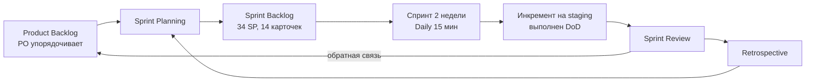

# Задача 28: Мессенджер для учебных групп

**Студент:** Яцко В.А.

## Постановка

Полный цикл: составьте Product Vision в одном абзаце, роли Scrum, бэклог на первый релиз, Kanban-доску первого спринта (не меньше 10 карточек) и разбор XP-практик: Pair Programming, Continuous Integration, Small Releases, Simple Design, Sustainable Pace (выберите не менее трёх и глубоко разберите на примерах задач доски).

## Решение

Дополнительные материалы: [`board.md`](board.md) (доска, WIP, снимки), [`examples/backlog.md`](examples/backlog.md) (бэклоги и карточки),
[`examples/burndown.md`](examples/burndown.md) (burndown), [`examples/ceremonies.md`](examples/ceremonies.md) (события, DoR/DoD, ретро).

---

## 1. Scrum

### Product Vision

> **Для** студентов и преподавателей вуза, **которые** теряют договорённости и дедлайны в разрозненных общих чатах,
> **«УчГруппа»** это групповой мессенджер для учебных курсов, **который** собирает всю переписку курса в одном месте с поиском
> по истории и вступлением по приглашению. **В отличие от** универсальных мессенджеров, он привязан к учётной записи вуза и
> структуре курса (группа = курс), поэтому участники проверены, а история и закреплённые дедлайны не теряются между семестрами.

Критерий успеха первого релиза: пилотная группа ПИ-21 (24 студента + преподаватель) целую неделю общается только в «УчГруппе».

### Команда и роли (7 человек)

| Роль | Кто | Зона ответственности в этом проекте |
|---|---|---|
| **Product Owner** | Мария Орлова (доцент кафедры) | Владеет Product Backlog и порядком приоритетов; принимает истории по критериям приёмки; говорит «нет» лишнему (например, отложила вложения) |
| **Scrum Master** | Дмитрий Лебедев | Следит за процессом, убирает препятствия (добыть VPS у IT вуза, договориться о доступе к OAuth-стенду), модерирует события; не руководит разработчиками |
| **Developers** (самоорганизующаяся команда) | Игорь (backend), Олеся (backend/realtime), Артём (frontend), Света (QA-инженер), Павел (DevOps/backend) | Вместе отвечают за инкремент: проектируют, пишут код и тесты, деплоят; тестируют все, а Света ведёт стратегию тестирования |
| Стейкхолдеры | староста ПИ-21, деканат, IT вуза | Участвуют в Sprint Review, дают обратную связь; в команду не входят |

### Product Backlog на первый релиз (R0.1 «Пилот»)

Порядок = приоритет. Оценка в story points (SP), значения Фибоначчи. Полные критерии приёмки: [`examples/backlog.md`](examples/backlog.md).

| ID | История / задача | SP | MoSCoW | Спринт |
|---|---|---|---|---|
| PB-T1 | Техническая: репозиторий, CI, окружение в Docker Compose | 5 | Must | 1 |
| PB-01 | Как студент, я вхожу через учётную запись вуза, чтобы не заводить новый пароль | 5 | Must | 1 |
| PB-02 | Как преподаватель, я создаю группу курса | 3 | Must | 1 |
| PB-03 | Как студент, я вступаю в группу по приглашению-ссылке | 5 | Must | 1 |
| PB-04 | Как участник, я отправляю сообщение в группу | 5 | Must | 1 |
| PB-05 | Как участник, я вижу новые сообщения сразу, без перезагрузки | 8 | Must | 1 |
| PB-06 | Как участник, я читаю историю (последние 50 сообщений в спринте 1, затем постранично) | 3 | Must | 1 |
| PB-07 | Как участник, я ищу сообщения по тексту | 5 | Should | 2 |
| PB-08 | Как участник, я вижу список участников и кто онлайн | 3 | Should | 2 |
| PB-09 | Как преподаватель, я закрепляю сообщение (дедлайн) | 3 | Should | 2 |
| PB-12 | Как преподаватель, я удаляю сообщение и исключаю нарушителя | 5 | Should | 2 |
| PB-10 | Как участник, я прикрепляю файл до 10 МБ | 8 | Could | 3 |
| PB-11 | Как участник, я получаю уведомление об упоминании `@имя` | 8 | Could | 3 |
| PB-13 | Тёмная тема | 2 | Won't (R0.1) | — |

Итого Must = 34 SP (спринт 1), Should = 16 SP (спринт 2), Could = 16 SP (спринт 3, под вопросом).

### Sprint 1 (2 недели, 10 рабочих дней)

**Sprint Goal:** *«К концу спринта участник группы может войти через вуз, вступить в группу по приглашению и обмениваться
сообщениями в реальном времени с историей: работающий вертикальный срез на staging».*

* **Sprint Backlog:** PB-T1, PB-01…PB-06 = **34 SP**, декомпозированы на 14 карточек (см. [`board.md`](board.md)).
* **Ёмкость:** 5 разработчиков × 10 дней × 6 ч фокуса = 300 ч, минус события (≈ 10 ч на человека) = **≈ 250 ч**, то есть ≈ 7,4 ч на SP.
  Первый спринт, исторической скорости нет, поэтому прогноз 34 SP взят с запасом около 15 % (в бэклоге Must не больше).
* **Цель гибкая по объёму, но жёсткая по смыслу:** состав истории PB-06 (пагинация) PO согласен урезать до «последние 50», если поток замедлится.

### События Scrum в этом спринте

| Событие | Когда | Длительность | Результат |
|---|---|---|---|
| Sprint Planning | день 1, 09:30 | 2 ч (что) + 2 ч (как) | Sprint Goal, Sprint Backlog, карточки на доске |
| Daily Scrum | ежедневно 09:30 | 15 мин | план на день вокруг цели; блокеры → Scrum Master |
| Backlog Refinement | день 5 | 1 ч | PB-07…PB-09 получают критерии приёмки и оценку (готовы к Planning 2) |
| Sprint Review | день 10, 15:00 | 1 ч | демо на staging для PO, старосты, деканата; обратная связь в бэклог |
| Retrospective | день 10, 16:15 | 1 ч | 2–3 улучшения на следующий спринт |

**Артефакты и обязательства:** Product Backlog → *Product Goal* (пилот ПИ-21); Sprint Backlog → *Sprint Goal*; Increment → *Definition of Done*.
DoR и DoD: [`examples/ceremonies.md`](examples/ceremonies.md).



---

## 2. Kanban

Доска первого спринта: колонки **Backlog → Ready → In Progress → Review → Testing → Done** и отдельная полоса **Blocked**,
с WIP-лимитами. Полная легенда, правила перехода, формат карточки и два снимка (день 3 и день 6): [`board.md`](board.md).

Снимок **конца 6-го дня** (кратко):

```
Backlog│ Ready (≤4) │ In Progress (≤3) │ Review (≤2) │ Testing (≤2) │ Done
PB-07… │ K-09       │ K-06 ◄ пара      │ K-05        │ K-03         │ K-01
PB-08… │ K-11       │ K-08 ◄ пара      │ K-07        │ K-10         │ K-02
       │ K-12       │                  │ ■ 2/2       │ ■ 2/2        │ K-04
       │            │                  │             │              │ K-13
Blocked: K-14 «Staging-деплой» (ждём VPS от IT вуза, 2 дня)
```

**Узкие места и поток:**

1. **Review и Testing заполнены (2/2)**, а в Ready стоят три готовых к работе карточки. WIP-лимит сработал как задумано: брать новое нельзя,
   пока не освободятся места справа. Пока застряли K-03, K-05, K-07, K-10, burndown стоит на месте (29 SP из 34 осталось на 6-й день при идеальных 13,6).
2. **Причина:** тестирует почти только Света; ревью делают двое. Работа копится *перед ними*, а не там, где её делают.
3. **Решения (правила, а не героизм):** «закончить прежде, чем начинать»: свободный разработчик сначала берёт ревью/тестирование, и только потом новую карточку
   из Ready; K-08 и K-06 ведутся парами, что сокращает ревью (код уже смотрели двое); Света учит Олесю и Павла писать приёмочные проверки.
4. **Blocked:** K-14 блокирует Sprint Goal («на staging»); Scrum Master эскалирует IT вуза и, если за 2 дня нет VPS, поднимает staging на облачном
   бесплатном тарифе: решение принято на Daily, а не через почту.

Метрики потока (на день 6): среднее время цикла завершённых карточек ≈ 2,3 дня; пропускная способность ≈ 0,67 карточки в день (цель ≥ 1,4);
самая «старая» карточка — K-03 (в работе с 2-го дня, т.е. 5 дней, из них 2 в Testing).

---

## 3. XP-практики (разобраны 4 из 5)

### 3.1 Pair Programming: карточка K-08 «WebSocket-канал группы»

**Что делает команда.** Олеся (backend) и Артём (frontend) работают одной парой над K-08 по схеме *driver/navigator*, меняясь ролями каждые 25 минут
(таймер Pomodoro). Пары перетасовываются ежедневно: K-06 ведут Павел с Игорем, чтобы знание об инвайтах и БД не оставалось в одной голове.

**Пример.** Олеся пишет серверную часть канала, Артём как навигатор вслух замечает: «а что получит клиент после обрыва связи?».
Так на первой же сессии выявлено, что после переподключения порядок сообщений может нарушиться. Решение: клиент при подключении присылает `last_id`,
сервер досылает пропущенное по курсору (то же поле, что понадобится в K-09). Без пары контракт между фронтом и бэком согласовывался бы «потом»,
и расхождение всплыло бы в Testing у Светы через 3–4 дня.

**Зачем / эффект.** Контракт клиент–сервер согласован сразу; код уже видели двое, поэтому **ревью занимает минуты** (прямой ответ на узкое место
из раздела Kanban); знание распределяется (bus factor: 1 → 2).

**Риск без практики.** Знание о WebSocket-протоколе остаётся у Олеси; при её болезни K-08 встаёт. Баги согласования ловятся на последнем этапе.

**Цена и правила.** Две пары занимают 4 из 5 разработчиков, поэтому `WIP In Progress ≤ 3`. Парой делают только сложное (K-06, K-08);
рутина (K-04 миграции, K-13 контракт) идёт соло + ревью. Пара не должна длиться без перерывов: максимум 4 ч в день (см. Sustainable Pace).

### 3.2 Continuous Integration: карточки K-01, K-07, K-05

**Что делает команда.** Карточка K-01 (Павел) создаёт пайплайн: на каждый push и Pull Request запускаются линтер, юнит-тесты, интеграционные тесты
в Docker Compose (api + PostgreSQL + Redis) и сборка образа. Разработка идёт **короткими ветками (до 1 дня)** с вливанием в `main` минимум раз в день;
`main` всегда зелёный.

**Пример.** K-05 (`POST /groups`, Игорь) и K-07 (`POST /messages`, Олеся) оба меняют модель `Group`/`Membership`. Из-за ежедневной интеграции
конфликт обнаружился уже на 5-й день, на следующий день после начала параллельной работы: красный пайплайн Олеси показал, что проверка «автор состоит в группе» ломается после изменения `Membership` в K-05.
Исправили за 20 минут, пока оба помнили контекст. При слиянии «в конце спринта» это была бы многочасовая отладка.

**Правила.** Красный `main` чинится **первым** (правило 10 минут: либо чиним, либо откатываем коммит); без зелёного CI карточка не уходит в Review;
Definition of Done требует зелёного пайплайна и покрытия новых строк ≥ 80 %.

**Зачем / эффект.** Интеграционные проблемы всплывают сразу, а не на Sprint Review; ревью смотрит на смысл, а не на «а компилируется ли».
**Риск без практики:** «integration hell» в последние дни спринта, нестабильный staging, невозможность дать честное демо.

### 3.3 Small Releases: PB-03 → PB-06 и план R0.1

**Что делает команда.** Каждая карточка спринта должна быть выкладываемой на staging **сама по себе**; новое включается за *feature-флагами*.
Релизный план: спринт 1 — вертикальный срез на staging (внутренний релиз); конец спринта 2 — **R0.1 «Пилот»** для одной группы ПИ-21 (24 человека), поиск и закрепления;
спринт 3 — расширение (вложения, уведомления) по итогам пилота.

**Пример.** PB-06 «история» урезана до «последние 50 сообщений» (`GET /messages?limit=50`), а постраничная навигация вынесена в следующий релиз.
Благодаря этому уже на 7-й день можно показать цепочку «войти → вступить → написать → увидеть», не дожидаясь полной пагинации.
Ранняя версия сразу покажет, нужна ли пагинация вообще: если за неделю пилота в группе всего 300 сообщений, 50 последних может быть достаточно.

**Зачем / эффект.** Короткая обратная связь от настоящих пользователей (староста ПИ-21 на Review) и снижение риска «делали полгода не то».
**Риск без практики:** один большой релиз в конце семестра; ошибки в понимании, как студенты вступают в группы, обнаружились бы слишком поздно.

### 3.4 Sustainable Pace: планирование ёмкости и решение на 6-й день

**Что делает команда.** Ёмкость считается из **6 ч фокуса в день**, а не из 8; события вычитаются; прогноз берётся с запасом 15 %.
Договорённость: **без овертаймов, ночных деплоев и «выходных ради демо»**; WIP-лимиты защищают от многозадачности.
Если спринт под угрозой, меняем **объём**, а не часы людей.

**Пример.** На 6-й день burndown отстаёт (29 SP вместо 13,6). Команда не соглашается «поработать на выходных». Вместо этого на Daily принимаются меры:
(1) PO уже согласилась, что PB-06 ограничен последними 50 сообщениями; (2) K-12 (E2E smoke) остаётся в спринте, потому что без него нельзя подтвердить Sprint Goal;
(3) нагрузочный тест PB-T2 в спринт не берётся; (4) Scrum Master снимает блокер K-14. Sprint Goal сохраняется, а объём — переговорный.

**Зачем / эффект.** Предсказуемая скорость на длинной дистанции, меньше ошибок от усталости (особенно в Review и Testing, где копится очередь),
честная скорость как основа прогнозов следующих спринтов. **Риск без практики:** «героический» спринт, падение качества, выгорание,
после чего реальная скорость спринта 2 ниже.

### Как практики связаны между собой

Pair Programming сокращает очередь на **Review**; CI сокращает очередь на **Testing** (дешёвые проверки уже автоматизированы); Small Releases дают
возможность **урезать объём без срыва цели**, а Sustainable Pace гарантирует, что команда решает проблему потока процессом, а не переработками.
